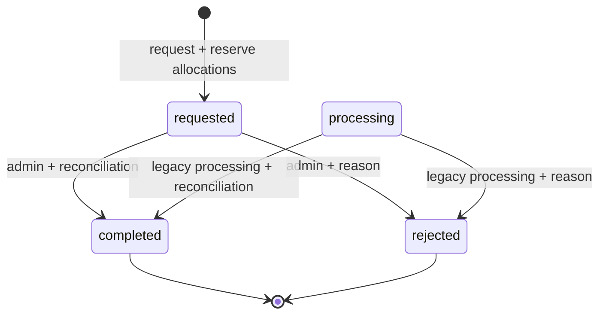

# Perbaikan royalti, payout, dan delivery pembayaran

## Root cause dan model baru

Implementasi lama mengubah pendapatan ledger lalu memakai `replicate()` untuk partial payout, membawa `order_item_id` unique. Contoh ledger Rp210.000 dan permintaan Rp100.000: sekarang ledger tetap Rp210.000, satu allocation Rp100.000 dicatat, saldo tersedia Rp110.000. Tidak ada ledger baru atau penghapusan unique constraint.

`royalty_ledgers` merekam penjualan immutable; `payout_allocations` merekam penggunaan pendapatan per payout. Allocation immutable dan tetap ada setelah penolakan, tetapi parent `rejected` tidak dihitung sebagai konsumsi saldo. `payout_audits` mencatat requested/completed/rejected beserta actor/time. Guards model serta trigger database melarang UPDATE/DELETE ledger, allocation, dan audit melalui SQL biasa. Ini tidak melindungi dari administrator database yang sengaja menghapus trigger/schema.

Semua nominal diproses sebagai integer minor units (dua desimal) lalu disimpan `DECIMAL(12,2)`. Tidak ada pengurangan/pembulatan finansial berbasis float. Royalti 70% memakai half-up; author + platform selalu gross. Input negatif, scientific notation, tiga desimal dan nilai melewati kapasitas ditolak.

## Transaksi, locking dan idempotency

- Seluruh operasi payout mengunci author terlebih dahulu; request berikutnya tidak dapat menggunakan saldo yang sama, termasuk saat tidak ada baris ledger.
- Ledger diurutkan `created_at`, lalu `id` (FIFO); saldo yang sudah requested/processing/completed dikurangi sebelum alokasi.
- Unique `(author_id,idempotency_key)` dan unique `(payout_request_id,royalty_ledger_id)` dipertahankan di DB. Key/nominal sama mengembalikan request sebelumnya; key sama dengan nominal berbeda gagal. Form memakai UUID, sehingga submit retry tidak membuat request baru.
- Minimum Rp100.000, KYC verified, user aktif dan rekening lengkap wajib. Flag payout diperiksa sebelum write.
- Admin harus aktif. `requested/processing` boleh completed atau rejected. Terminal state tidak bisa dibalik; pengulangan aksi dengan detail sama idempotent, detail berbeda ditolak. Completion/rejection merekonsiliasi nominal alokasi dan pendapatan sebelum menulis audit.
- Reject tidak mengubah original ledger dan membebaskan saldo lewat status parent. Completion hanya mencatat transfer manual yang telah dilakukan operator, bukan perintah transfer bank.

## Tiga migration

| Migration | Perubahan | Gate/rollback |
| --- | --- | --- |
| `2026_10_11_000001_create_payout_allocations.php` | Index author, idempotency key, allocations, audits, FK restrict, unique/positive constraint, immutable triggers; backfill linked legacy ledger | Preflight **sebelum DDL** membandingkan gross dengan order item, author/platform/gross/persentase, link/status/author dan nominal active/completed payout. Mismatch berhenti, tidak memperbaiki nominal diam-diam. Down menolak sesudah new request/audit; clean down/up dan historical full payout teruji. |
| `2026_10_11_000002_expand_encrypted_financial_columns.php` | Enam kolom rekening/snapshot dan `orders.snap_token` menjadi nullable TEXT | Ciphertext tidak muat VARCHAR lama. Down memeriksa semua panjang sebelum narrowing dan menolak potensi kehilangan data. Backfill enkripsi bank terpisah, bukan migration otomatis. |
| `2026_10_11_000003_create_order_paid_outbox.php` | Outbox satu per order, FK restrict, dispatched index, marker `confirmation_sent_at` | Down menolak bila ada outbox/marker konfirmasi. Clean down/up teruji; production downgrade setelah write membutuhkan rencana menjaga data. |

Kolom ledger lama `status/payout_request_id` dipertahankan sebagai snapshot kompatibilitas historical rollback, tetapi perhitungan saldo baru memakai allocations. Index `payout_author_lookup` dipertahankan pada down agar FK MariaDB tetap memiliki index setelah index unique idempotency dihapus.

MySQL/MariaDB DDL dapat auto-commit; gangguan sesudah preflight bisa meninggalkan schema parsial. Jangan mengulang migration buta atau menghapus tabel finansial. Maintenance/backup, pemeriksaan index/trigger dan staging rehearsal wajib. Ledger historical yang pernah displit/diubah akan gagal preflight; pemilik harus merekonsiliasi dari bukti privat, tidak melonggarkan check.

## Payment/event/queue

Webhook menggunakan hash SHA-512 sesuai Midtrans dan `hash_equals`, key kosong ditolak; payload divalidasi sebelum enqueue. Worker mengunci order, memeriksa gross persis, fraud/status dan hanya mengubah pending order. Failed/expired/success terminal tidak dihidupkan kembali. Lisensi unik user/book dibuat idempotent.

Outbox dicatat di transaksi order/license, lalu dikirim setelah commit. Gagal publication meninggalkan row pending untuk `payments:dispatch-events`, dijadwalkan setiap menit tanpa overlap. Listener royalti mengunci order dan mempertahankan unique order item. Listener mail mengunci order dan mencatat konfirmasi yang selesai; error kembali ke mekanisme retry, bukan ditelan sebagai sukses.

Default database queue harus memakai **connection database yang sama** dengan order/outbox agar enqueue jobs dan marker commit atomik. Redis/SQS atau database queue terpisah belum diuji dalam scope ini; jangan mengganti backend tanpa rehearsal/review. Queue worker/scheduler harus aktif dan failed jobs dipantau. Royalty flag false memang melewatkan pencatatan royalti; mengaktifkan kembali flag tidak otomatis membuat royalti untuk order historical yang sudah delivered. Backfill royalti historis tidak disediakan/dijalankan otomatis.

**Batas email:** SMTP tidak menyediakan transaksi bersama database. Bila SMTP menerima pesan lalu proses mati sebelum marker commit, retry masih dapat mengirim ulang. Ini bukan jaminan exactly-once email. Batas tersebut tidak menduplikasi ledger/payout; solusi exactly-once memerlukan dukungan idempotency provider dan integrasi terpisah. Uji live provider belum dilakukan.

Manual checkout rescope menggunakan `ManualOrder/LibraryAccessGrant`, terpisah dari legacy `Order/BookLicense`; validasi nominal/state/ownership diperketat tanpa menambahkan royalti atau event Midtrans ke flow manual yang belum memiliki model tersebut.

Enkripsi rekening baru memakai `enc:v1:` + Laravel Crypt; plaintext lama bisa dibaca selama transisi. Sesudah backup dan persetujuan produksi, operator dapat menjalankan `security:encrypt-financial-data --approved-production`. Command idempotent dan hanya mencetak jumlah record; tidak pernah dijalankan live pada tugas ini. APP_KEY existing harus dipertahankan.
